# KBS Monitoring v2

KBS 16채널 방송 모니터링 시스템 v2 (현재 v2.8.22).

16채널 방송 화면과 소리를 0.2초마다 자동으로 살펴, 블랙·정지화면·오디오 이상을 즉시 화면·소리·텔레그램으로
알리고 사고 앞뒤 영상을 자동 녹화합니다. 전주총국 감시PC에서 실운영 중입니다(로그 보존 구간 90일, 가동률 하한
99.89% — 근거 `docs/성과_근거.md`).

v1(KBS Peacock v1.6.x)의 핵심 문제인 **"장기 운영 시 감지 루프 freeze"** 를 근본 해결하기 위해 multiprocessing 기반으로 완전 재작성했습니다. UI 프로세스와 Detection 프로세스를 분리하여 감지 루프가 UI 이벤트의 영향을 받지 않습니다.

---

## 주요 기능

**감지**
- **16채널 동시 모니터링** — 블랙·정지화면(스틸)·오디오 레벨미터(HSV 색)·임베디드 오디오 무음 4종, 0.2초 주기(설정으로 0.1~1초)
- **히스테리시스 기반 경보** — 진입/복구 타이머를 따로 둬 경계에서 깜빡이는 오탐 억제
- **정파 자동 처리** — 그룹별 시간표 + 화면 감지로 정파준비→정파→해제 자동 전환, 정파 중 해당 채널 경보 억제, 테스트 영상으로 반복 전환 시 알림 묶음

**알림·기록**
- **3중 알림** — 화면(감지영역 깜빡임) · 알림음 · 텔레그램(채널 썸네일 첨부). 화면 전체 블랙은 1통으로 묶음
- **순환버퍼 자동 녹화** — 사고 전(pre-roll)부터 MP4, ffmpeg으로 소리 합성

**스스로 버티는 구조 (무인 운영)**
- **Watchdog 자동 복구** — 감지 프로세스가 10초 응답 없으면 다시 띄우고 UI 상태 자동 복원. 반복해서 죽으면 간격을 늘리고 알림을 묶음
- **캡처 신호 상실 자동 복구** — 캡처보드가 신호를 잃고 검은 화면으로 굳으면 장치만 다시 연결(실운영 5회 모두 1~3초 안에 복구)
- **UI 멈춤·손상 감시** — 화면 프로세스가 30초 멈추거나 내부가 손상되면 Watchdog이 대신 `[SYSTEM]` 텔레그램 발송
- **기동 자가점검** — 켤 때마다 Python 버전·감지영역 수·ffmpeg·디스크 여유를 점검해 화면 로그와 텔레그램으로 보고
- **오디오 장치 실패 알림** — 소리 장치를 60초 못 열면 알리고, 그 구간을 무음으로 쳐 경보
- **예약 재시작** — 정해진 주기로 스스로 재시작(정파 시간대 등 제외 가능)
- **텔레그램 발송 주체 분리** — 감지 이벤트(Detection)와 프로세스 생존(Watchdog)을 따로 보내 감지 프로세스가 죽어도 알림 보장

**화면**
- **7탭 설정창** — 영상설정 · 비디오 영역 설정 · 오디오 레벨미터 영역 설정 · 감도설정 · 정파설정 · 알림설정 · 저장/불러오기
- **창 크기 대응** — 화면 절반 크기 창까지 지원(좁으면 상단바가 두 줄로), 로그창은 영상이 크게 나오는 쪽(오른쪽/아래)에 자동 배치
- **이상 상태만 빨강** — 상단바는 감지 OFF·음소거처럼 주의가 필요한 상태만 빨갛게 표시
- **사용안내 내장** — 로그창 머리줄 「?」 버튼이 `manual/사용안내.html`을 브라우저로 연다(인터넷 불필요, `Ctrl+P`로 PDF 저장 가능)

---

## 스크린샷

> 그림은 `manual/capture_screens.py`로 찍습니다(메인 창 = 운영 중인 화면, 설정창 = 따로 띄워 탭별 캡처,
> 텔레그램 토큰·채팅 ID는 가림). 화면이 바뀌면 이 명령 한 번으로 다시 찍으세요.

### 메인 모니터링 화면

16채널 실시간 그리드와 시스템 로그를 한 화면에서 확인합니다. 빨간 테두리는 비디오 감지영역,
주황 테두리는 오디오 레벨미터 감지영역입니다(`영역 표시 ON`일 때). 경보가 나면 해당 영역이 채워지며 깜빡입니다.

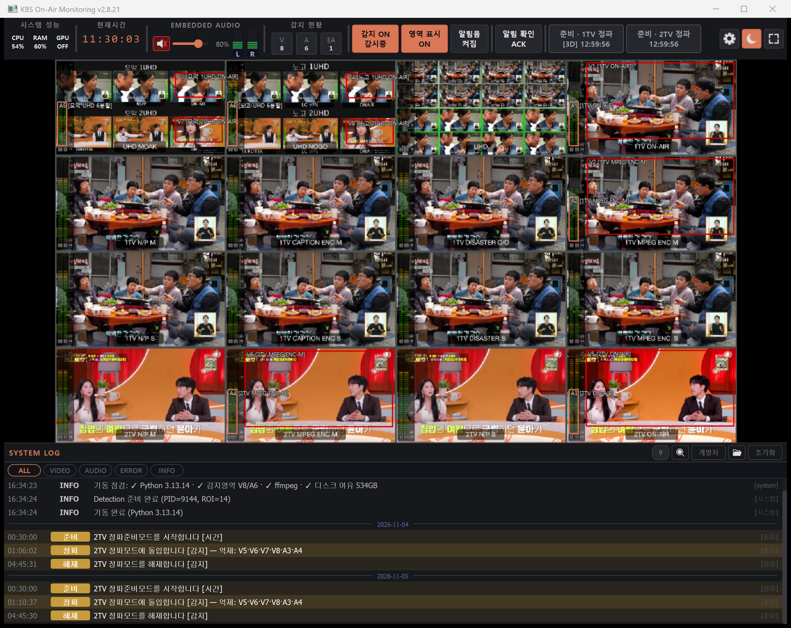

### 설정 다이얼로그

<details>
<summary>7탭 설정 다이얼로그 스크린샷 펼치기</summary>

**영상설정** — 캡처 포트(또는 영상 파일), 자동 녹화(사고 전·후 구간, 보관 기간), 녹화 해상도/FPS, 화면 배치를 설정합니다.

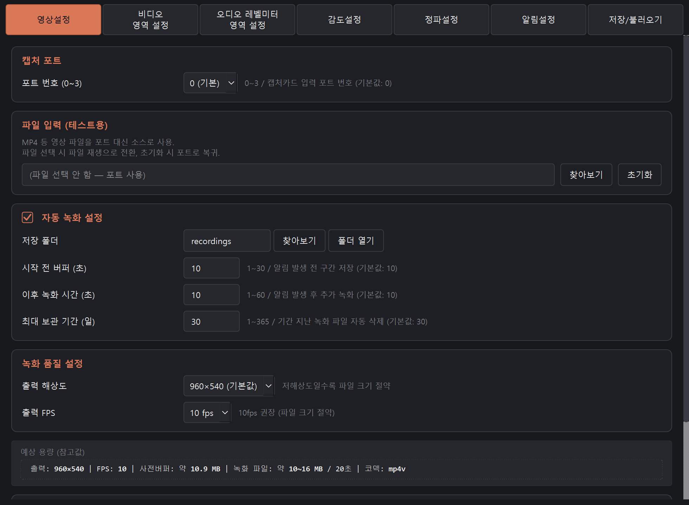

**비디오 영역 설정** — 채널별 감지영역을 표에서 편집하거나, 영상 위에서 직접 그려 편집합니다.

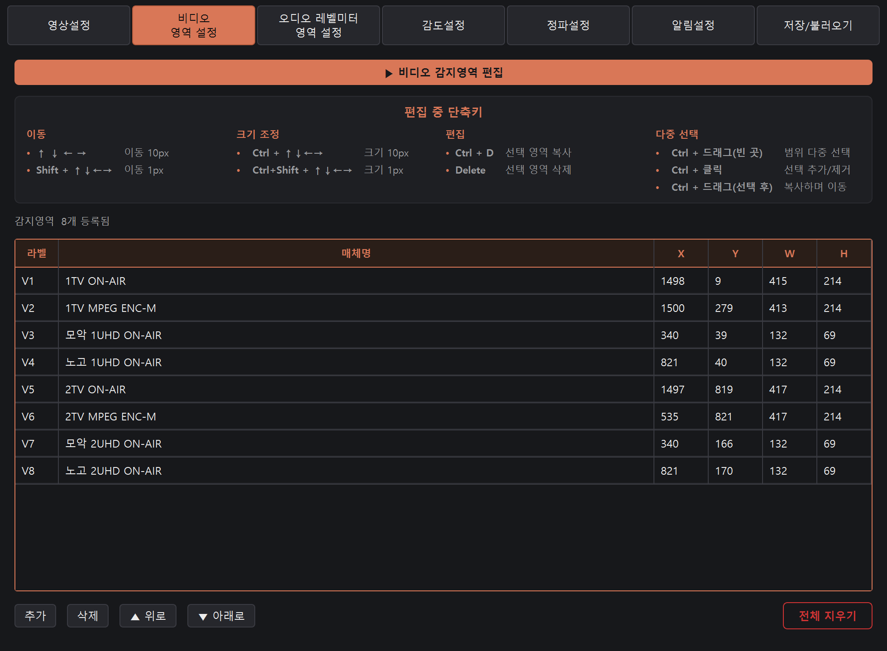

**오디오 레벨미터 영역 설정** — 화면 속 오디오 레벨미터 감지영역을 등록합니다.

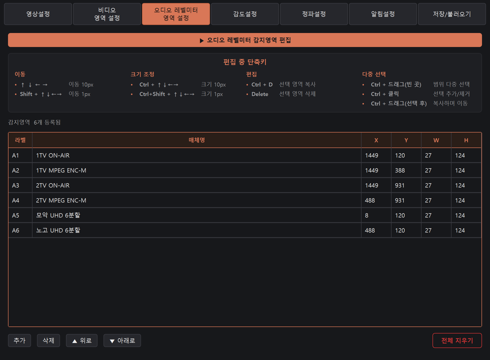

**감도설정** — 블랙·스틸·오디오 레벨미터(HSV)·임베디드 오디오 감지 기준과 감지 주기·해상도 스케일을 조정합니다.

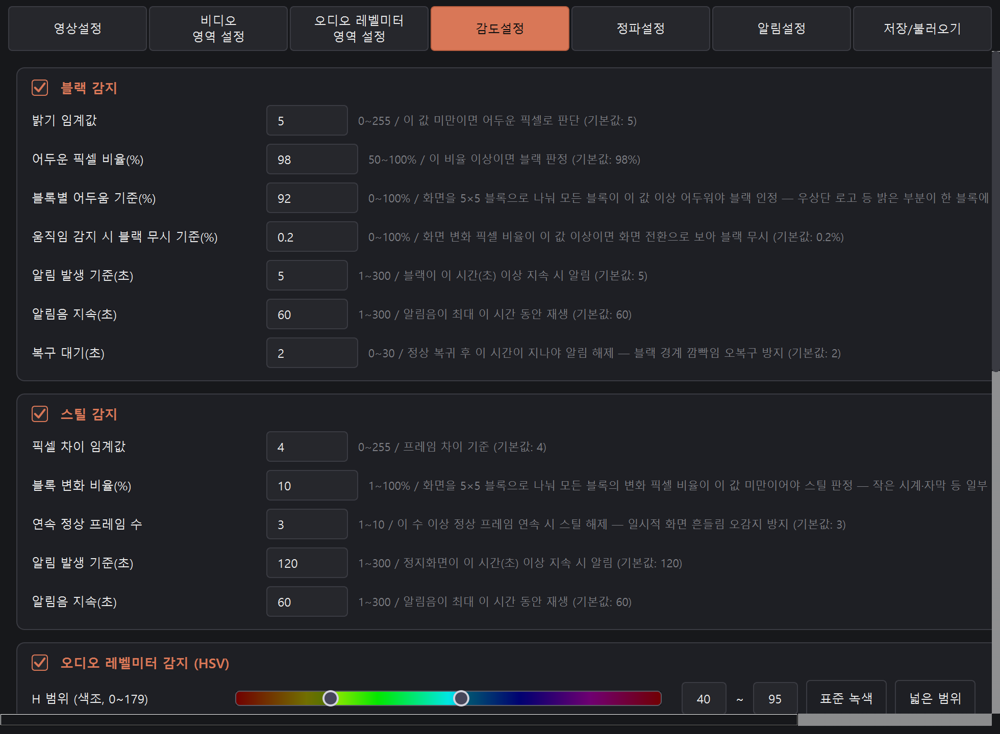

**정파설정** — 그룹별 정파 시각과 요일, 정파 진입 트리거 영역과 억제 대상, 정파 알림음을 지정합니다.

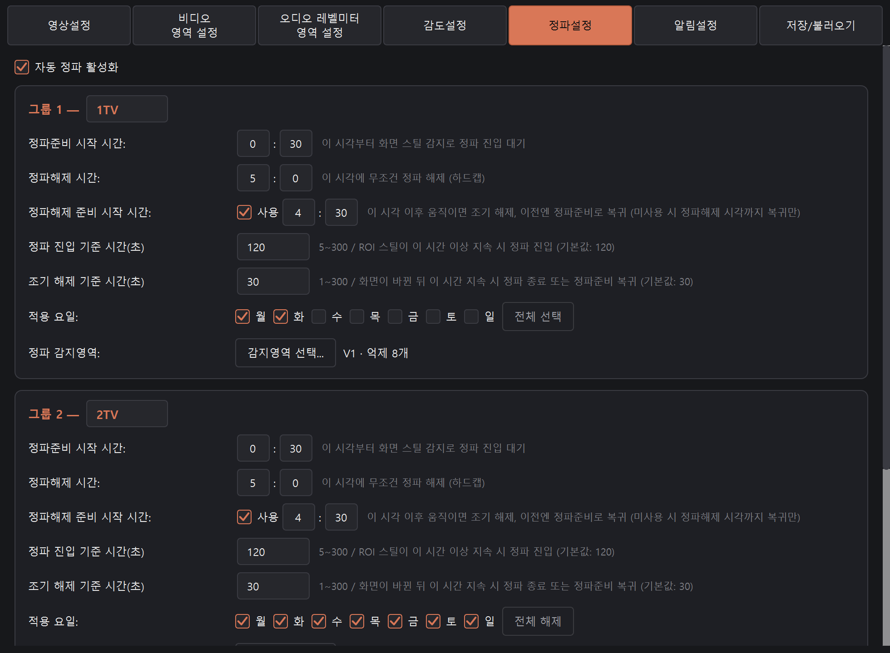

**알림설정** — 알림음, 텔레그램 봇 연동과 종류별 발송 여부, 시스템 알림, 예약 재시작을 설정합니다.

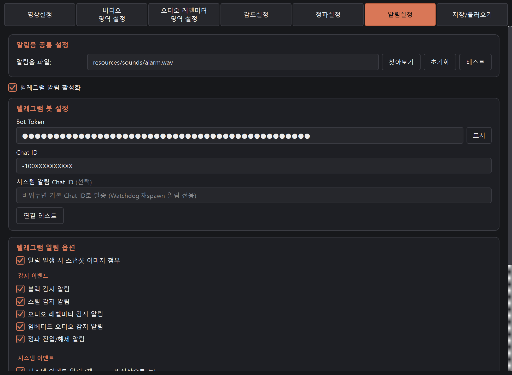

**저장/불러오기** — 설정을 JSON으로 내보내거나 불러오고, 버전 정보를 확인합니다.

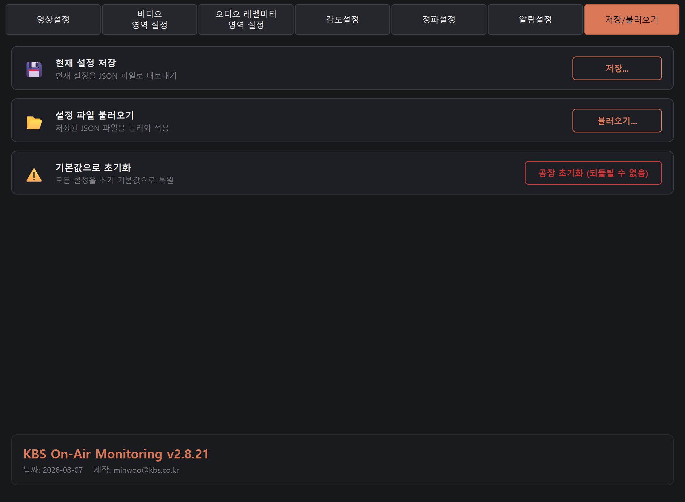

</details>

---

## 텔레그램 알림 예시

실제 운영 중 수신된 알림입니다. 감지 이벤트는 채널 그리드 캡처와 함께, 시스템 이벤트는
`[SYSTEM]` 접두사로 발송됩니다.

**감지 이벤트** — 블랙·오디오·정지화면을 채널 썸네일과 함께 즉시 알립니다.

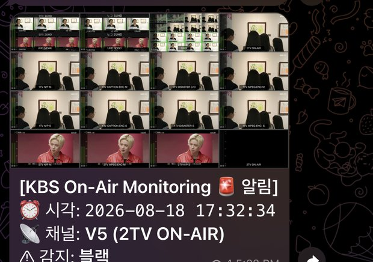
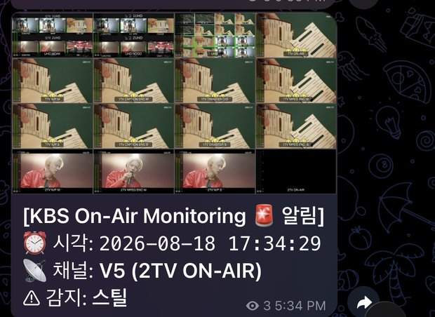

**임베디드 오디오 — 감지와 복구를 모두 알림.**

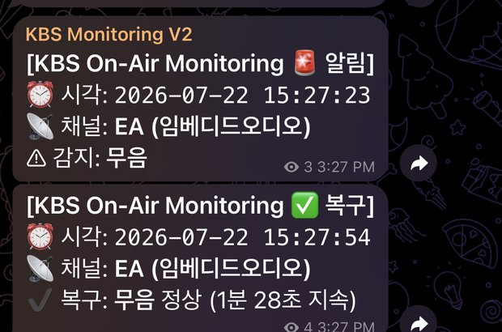

**정파 진입/해제 — 그룹·트리거 채널·억제된 채널·정파 지속시간을 함께 안내.**
시스템 기동도 `[SYSTEM]` 알림으로 별도 발송됩니다.

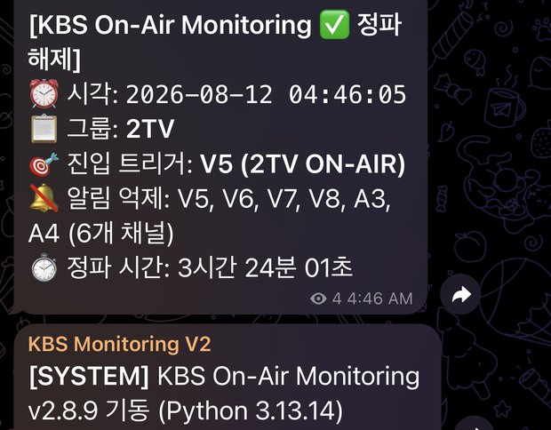

**정파 변동 반복 억제** — 짧은 시간 내 정파 진입/복귀가 반복되면(테스트 영상 송출 등)
개별 알림을 묶어 스팸을 막고, 안정화되면 요약 알림 하나로 정리해 보냅니다.

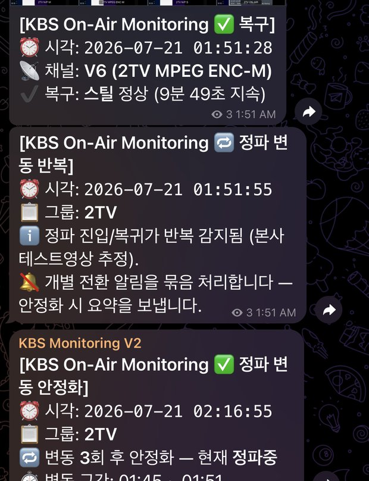

**Watchdog 자가진단** — Detection 프로세스뿐 아니라 UI 프로세스 이상까지 감지해
`[SYSTEM]` 알림으로 즉시 보고합니다. 아래는 실제로 UI 프로세스 손상을 잡아내
재시작을 요청한 사례(2026-08-11, 손상 1초 뒤 발송)입니다. 원인은 배포 과정에서 파이썬 버전이
의도치 않게 바뀐 것으로 규명됐고, Python 3.13으로 고정한 뒤 85일간 재발하지 않았습니다.

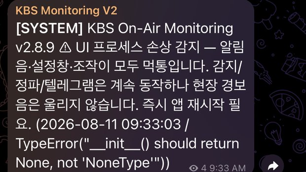

---

## 아키텍처

```
main.py  (UI 프로세스 + Launcher)
  ├─ SharedMemory 생성·잔존 정리
  ├─ result_queue / cmd_queue / shutdown_event 생성
  ├─ Watchdog Process spawn
  └─ QApplication + MainWindow 실행

UI Process (PySide6 이벤트 루프)
  ├─ UIBridge (QThread)          result_queue 폴링 → Qt Signal 변환
  ├─ SharedFramePoller (QTimer)  ~33ms, seq_no 변경 시 프레임 갱신
  ├─ AlarmSystem                 시각/청각 알림 + Ack 상태 관리
  ├─ ui_heartbeat.dat            2초마다 시각 기록 (Watchdog의 UI 멈춤 감시용)
  └─ DetectionReady 수신 시      런타임 상태 재주입 (설정·ROI·볼륨 등)

Watchdog Process
  ├─ heartbeat.dat 감시          10초 무응답 → Detection kill 후 재spawn (반복 시 간격 증가)
  ├─ UI 생존 감시                10초 주기 psutil — 사망 시 Detection 정리 후 자신 종료
  ├─ UI 정지 감시                ui_heartbeat.dat 30초 무갱신 → "UI 응답 없음" 알림
  ├─ UI 손상 통보                ui_degraded.flag 발견 시 대신 텔레그램 발송
  ├─ 기동 자가점검               Python·감지영역·ffmpeg·디스크 → 텔레그램 + 화면 로그
  └─ 텔레그램 직접 발송          [SYSTEM] prefix — Detection이 죽어도 알림 보장

Detection Process  (PySide6 임포트 없음)
  ├─ VideoCaptureWorker          threading.Thread
  ├─ AudioMonitorWorker          threading.Thread, sounddevice 단독 소유
  ├─ DetectionEngine             블랙/스틸/HSV/임베디드
  ├─ CaptureWatchdog             화면 전체 검은 정지 → 캡처 장치 재연결
  ├─ SignoffManager              threading.Thread, 정파 상태 관리
  ├─ AutoRecorder                순환버퍼 + ffmpeg
  ├─ TelegramWorker              [DETECT] 감지 이벤트 알림
  └─ HeartbeatWriter             5초 주기 heartbeat.dat 갱신 (메인 루프 20초 무응답 시 중단)
```

### 프로세스 간 통신

| 채널 | 방향 | 용도 |
|------|------|------|
| SharedMemory `kbs_frame_v2` | Detection → UI | 프레임 픽셀 (~6 MB) |
| SharedMemory `kbs_state_v2` | 양방향 | detection_enabled, mute, volume, L/R 레벨미터 |
| `result_queue` (maxsize=200) | Detection → UI | 감지결과, 알림이벤트, 로그, DIAG |
| `cmd_queue` (maxsize=50) | UI → Detection | 설정변경, ROI업데이트, 정파명령 |

세부 스펙: `docs_ipc_spec.md`

---

## 설치

처음 설치하는 PC는 아래 순서대로 합니다. 비개발자용 안내는 `★ KBS Monitoring v2 설치 안내.txt`.

1. **`python313_전환.bat`** 더블클릭 — Python 3.13이 없으면 winget으로 설치하고, 전용 환경(`.venv313`)을 만들어
   `requirements.txt`의 고정 버전 패키지를 설치합니다.
2. **`install_ffmpeg.bat`** 더블클릭 — 녹화 영상에 소리를 합성할 ffmpeg 설치. 없으면 소리 없는 MP4로 녹화(에러 아님).
3. **`실행.bat`** 더블클릭.

> ⚠ **Python 3.14로 돌리지 마세요.** 3.14 계열에서 장기 가동 시 화면 프로세스가 손상되는 사고가 6번 있었습니다
> (`fix/260526_설정다이얼로그_TypeError_재현불가.md`). `.venv313`은 gitignore 대상이라 **새로 clone할 때마다 1번을 다시**
> 해야 합니다. 없으면 `실행.bat`이 콘솔과 `logs/stderr_debug.txt`에 NOTICE를 남기고 기본 Python으로 실행합니다.
> 기동 후 화면 로그의 `기동 점검: ✓ Python 3.13.x`를 확인하세요.

> 새로 clone하면 `config/kbs_config.json`(운영 설정)이 없어 **감지영역 0개 · 텔레그램 OFF**로 뜹니다(정상).
> `저장/불러오기` 탭에서 백업을 불러온 뒤 **재기동**해야 `[SYSTEM]` 텔레그램까지 나갑니다(`CLAUDE.md` "신규 빌드 배포 시 함정").

### 패키지 (requirements.txt, 버전 고정)

| 패키지 | 용도 / 미설치 시 동작 |
|--------|--------------|
| `PySide6` | 화면(UI) |
| `opencv-python`, `numpy` | 영상 캡처·감지 |
| `sounddevice` | 오디오 캡처. 없으면 더미 신호로 동작 |
| `psutil` | 프로세스 생존·자원 감시 |
| `GPUtil` | GPU 사용률. 없으면 N/A (기본 OFF) |
| `pycaw` | 시스템 볼륨 제어. 없으면 제어 불가 |
| `requests` | 텔레그램 발송 |

---

## 실행

`실행.bat` 더블클릭 (권장). `.venv313`을 자동으로 쓰고, 예약 재시작 시 자동 재가동(종료코드 42 → 배치 루프 재실행)이
이 래퍼를 통해서만 동작하므로 운영 환경에서는 반드시 `실행.bat` 으로 실행한다.

- PC 켤 때 자동 시작: `자동시작 등록.bat` / 해제: `자동시작 해제.bat`
- 두 번 실행하면 "이미 실행 중" 안내 후 두 번째는 종료된다.

```bash
# 직접 실행도 가능하나 예약 재시작 자동 재가동은 동작하지 않음
.venv313\Scripts\python.exe main.py
```

---

## 개발 현황

| Phase | 내용 | 상태 |
|-------|------|------|
| 0-A | 저장소 초기화 + 설계 문서 확정 | ✅ 완료 |
| 0-B | 패키지 골격 + IPC 정합성 테스트 | ✅ 완료 |
| 1 | Detection 프로세스 독립 실행 + 단위테스트 | ✅ 완료 |
| 2 | UI 프로세스 + IPC 연결 + 다크 테마 | ✅ 완료 |
| 3 | 알림 + 정파 + ROI 편집 + 설정 다이얼로그 | ✅ 완료 |
| 4 | Watchdog + Launcher 완성 + 예약 재시작 | ✅ 완료 |
| 5 | 통합 검증 (DIAG 완성 + 버퍼 상한) | ✅ 완료 |
| 6 | 무인 배포 하드닝 (자가복원·이식성·운용성) | ✅ 완료 |
| 운영 | 전주총국 감시PC 실운영 + 현장 대응 | 🔄 운영 중 |

자동 테스트 94개 통과(2026-11-05). 진행 기록: `PROGRESS.md` · 실적 숫자: `docs/성과_근거.md`

---

## 파일 구조

```
kbs_monitoring_v2/
├── main.py                       # Launcher (faulthandler + sys.excepthook + cwd 고정)
├── processes/
│   ├── detection_process.py      # Detection 프로세스 진입점
│   └── watchdog_process.py       # Watchdog 프로세스
├── ipc/
│   ├── shared_frame.py           # SharedMemory 프레임 버퍼
│   ├── shared_state.py           # SharedMemory 상태 버퍼
│   └── messages.py               # Queue 메시지 dataclass
├── detection/                    # Detection 전용 모듈 (PySide6 없음)
├── ui/                           # PySide6 UI 모듈
├── core/
│   └── roi_manager.py            # ROI dataclass + 관리
├── utils/
│   ├── config_manager.py         # JSON 설정 저장/로드
│   └── logger.py                 # 프로세스별 파일 로그
├── config/
│   └── default_config.json
├── docs/                         # 성과 근거·종합점검·스크린샷·심사위원용 소개서(소개서/)
├── fix/                          # 사고 분석 기록
├── manual/                       # 사용안내 + 화면 캡처 스크립트
└── tests/
```

---

## 요구 환경

- Windows 10/11
- Python 3.13.x (`python313_전환.bat`이 설치) — 3.14 사용 금지
- 영상 캡처 카드 (전주 운영: `USB Capture SDI`, 임베디드 오디오는 같은 장치의 소리 입력)
- ⚠ 윈도우 설정 > 개인 정보 및 보안 > **마이크 액세스 켜기** — 꺼지면 캡처카드 소리도 못 받습니다
- NVIDIA GPU (선택, GPU 사용률 표시용)
